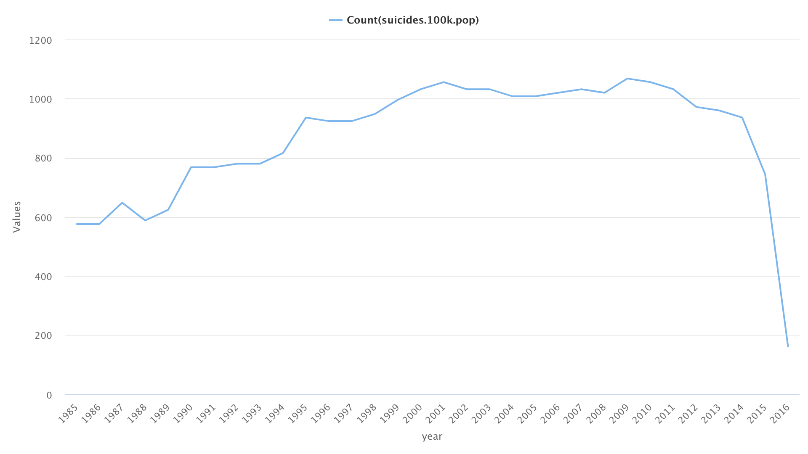
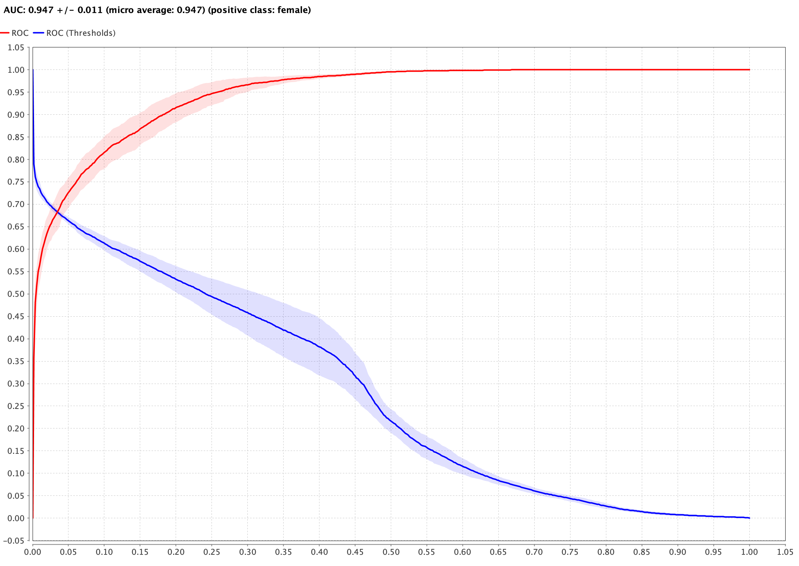
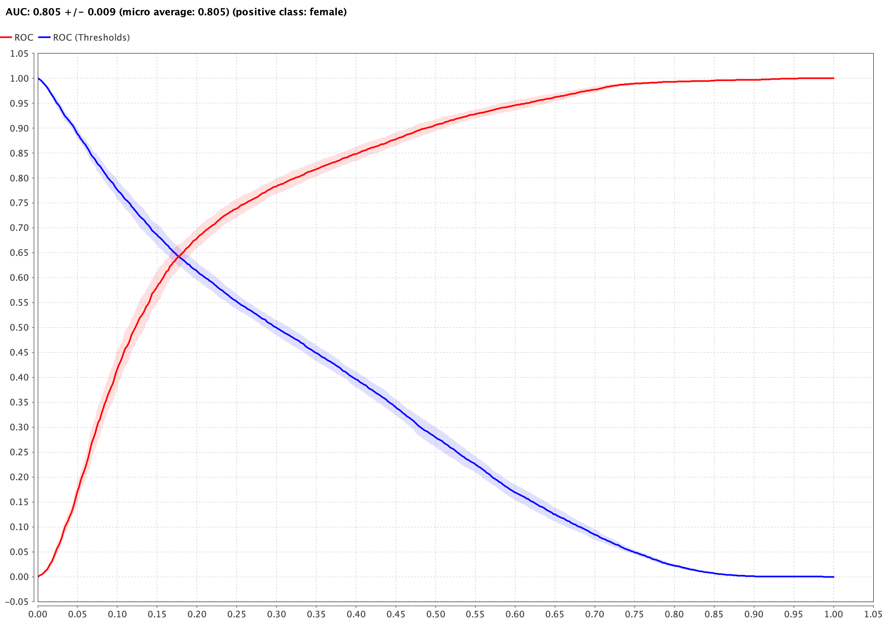
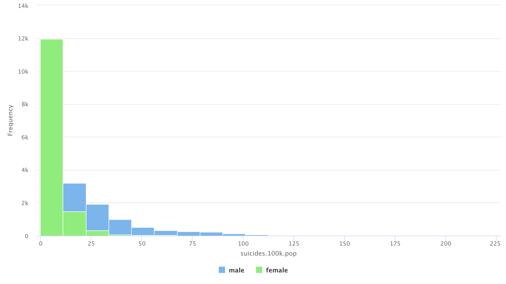
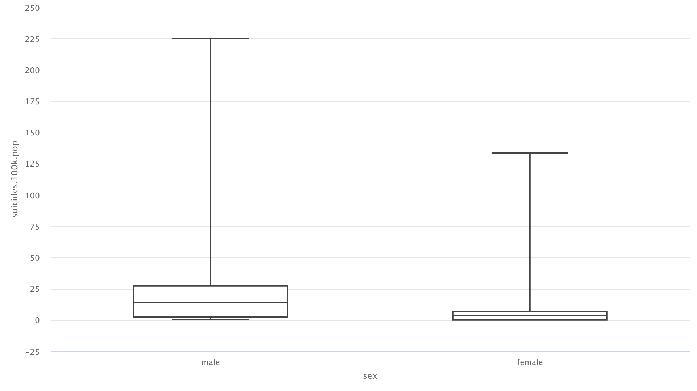
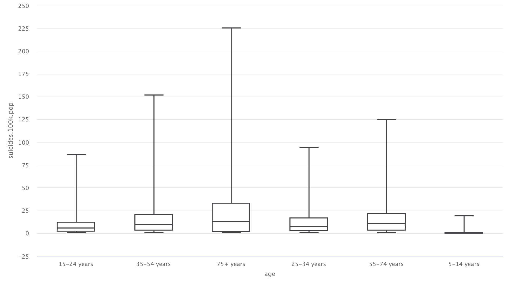
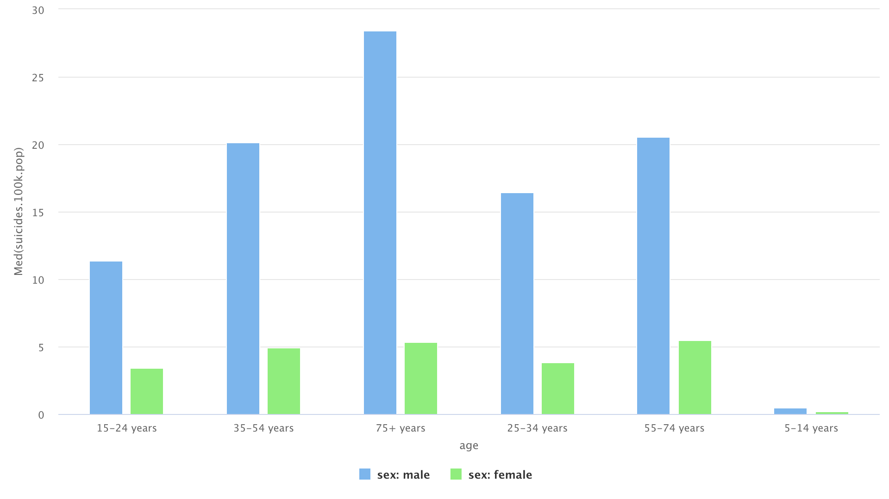
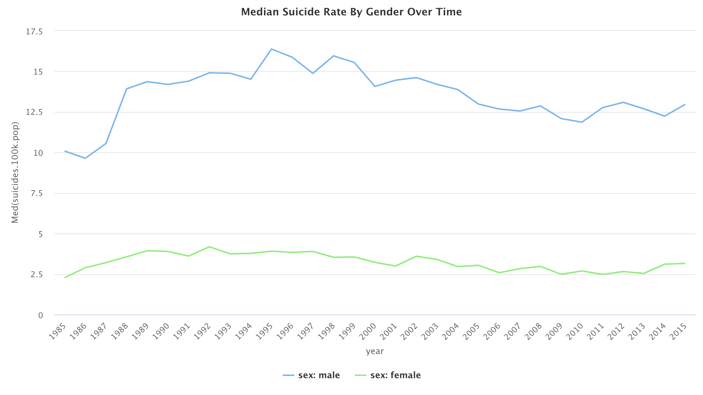
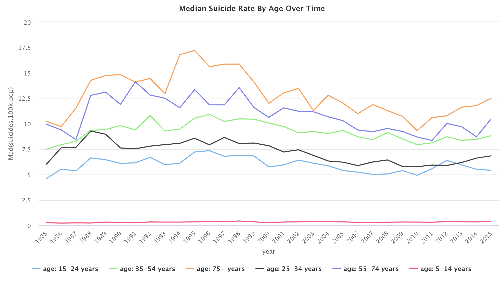

# Gender Classification on Global Suicide Data (1985–2015)

## Summary

**Research question:** Can the sex of a record be classified from age,
country, year, population, suicide rate and GDP — and does that confirm
gender as a risk factor for suicide?

**What is built:** two classification models — logistic regression and a
25-tree random forest — in a reproducible RapidMiner process, with the
pre-processing and exploration in R.

**How it helps:** it identifies which groups are most at risk (males, and
the 75+ age group, far above the rest), so health promotion resources can be
focused where the risk is highest.

This classifies the sex of a record in 20 years of global suicide data
(1985–2015), from age, country, year, population, suicides per 100,000 and
GDP. Two models: logistic regression and a random forest (25 trees, max
depth 10), evaluated on a 70/30 split plus 10-fold and 8-fold cross-validation,
against a **baseline** (majority class).

The models were built in RapidMiner 9.7; the pre-processing and exploration
were done in R. The RapidMiner process is in `rapidminer/`, the R code in
`analysis/`.

## Data

The raw file is `data/master.csv` (12 columns, 27,820 rows), from the Kaggle
dataset "Suicide Rates Overview 1985 to 2016" (compiled by user "Rusty",
[russellyates88](https://www.kaggle.com/russellyates88/suicide-rates-overview-1985-to-2016),
from four WHO datasets). Pre-processing drops the HDI column (69.8%
missing) and all rows from 2016 (160 rows — recording was incomplete, and the
count collapses in that year, as the chart below shows). After cleaning:
**27,660 rows**, 1985–2015.



The classes are exactly balanced: 13,830 male rows and 13,830 female rows,
so the majority-class baseline is **50.0%**.

## Results

All figures below are computed from the confusion matrices (10-fold and
8-fold cross-validation) — none are hand-copied.

| Model | 10-fold CV accuracy | 8-fold CV accuracy | AUC |
|---|---:|---:|---:|
| Baseline (majority class) | 50.00% | 50.00% | — |
| Logistic regression | 74.11% | 74.24% | 0.805 ± 0.009 |
| Random forest (25 trees, depth 10) | **86.02%** | 84.66% | **0.947 ± 0.011** |





| Model (10-fold CV) | Precision — male | Precision — female | Recall — male | Recall — female |
|---|---:|---:|---:|---:|
| Logistic regression | 76.26% | 72.29% | 70.03% | 78.20% |
| Random forest | 93.57% | 80.70% | 77.36% | 94.69% |

**What the numbers say:** the random forest is the better classifier on
every measure — accuracy 86.02% vs 74.11%, AUC 0.947 vs 0.805. Against the
50% majority-class baseline, logistic regression adds 24 points and the
forest adds 36. It is also the less even one: its recall gap between the
classes is about 17 points on 10-fold CV (77.36% male vs 94.69% female;
20.1 points on 8-fold), while logistic regression's is about 8 points
(70.03% vs 78.20%). The precision gap shows the same pattern (forest 12.9
points, logistic regression 4.0). Logistic regression's CV RMSE was 0.380
(R² 0.422). The forest was tuned by hand: depth 5 gave 75.07%, 25 trees gave
77.52%, and depth 10 with 25 trees gave 86.02%.

## Data exploration

Summary statistics for the cleaned data (27,660 rows, 1985–2015):

| Variable | Median | Mean | Q1 | Q3 | Max |
|---|---:|---:|---:|---:|---:|
| Suicides per 100,000 | 5.98 | 12.81 | 0.91 | 16.60 | 224.97 |
| Number of suicides | 25 | 243.41 | 3 | 132 | 22,338 |
| Population | 430,725 | 1,850,689 | 97,535 | 1,491,041 | 43,805,214 |
| GDP per capita ($) | 9,283 | 16,815.57 | 3,436 | 24,796 | 126,352 |

Suicide rate per 100,000 is not normally distributed — it is positively
skewed for both genders, which is why the median is used throughout.



- Males had a much higher median suicide rate than females: **13.52 vs 3.16**
  per 100,000. The difference is significant (Mann–Whitney U,
  W = 53,248,014, p < 2.2e-16).



- The oldest age group had the highest median rate (**75+ years: 12.47**);
  the youngest the lowest (**5–14 years: 0.32**), then 15–24 (5.92) and
  25–34 (7.28). The age effect is significant (Kruskal–Wallis
  chi² = 7,008.9, df = 5, p < 2.2e-16; one-way ANOVA F = 909.79,
  p < .001). By count rather than rate, the **35–54** group has the highest
  median number of suicides (87).



Median suicide rate by sex and age:

| Age | Male | Female |
|---|---:|---:|
| 5–14 years | 0.46 | 0.23 |
| 15–24 years | 11.39 | 3.41 |
| 25–34 years | 16.45 | 3.82 |
| 35–54 years | 20.15 | 4.91 |
| 55–74 years | 20.57 | 5.48 |
| 75+ years | 28.41 | 5.37 |



- The male rate has been consistently higher than the female rate across the
  whole period, 1985–2015, and the 75+ group has stayed highest throughout.





- Suicide rate per 100,000 is barely correlated with GDP per capita
  (Spearman rho = 0.073) and weakly with population size (rho = 0.215).

The Mann–Whitney U, Kruskal–Wallis and ANOVA figures above were computed on
the full file (2016 included) — the R code runs those tests before the 2016
exclusion, and all three reproduce exactly from `data/master.csv` on that
basis.

## Conclusion

The random forest is the model to use for this classification: 86.02%
accuracy and 0.947 AUC on 10-fold cross-validation, well clear of logistic
regression (74.11%, 0.805) and of the 50% baseline. The result supports
gender as a risk factor: the sexes separate cleanly in the data, and the male
rate is far higher. The trade-off is evenness — the forest is much better at
recognising female records (recall 94.69%) than male ones (77.36%), a gap of
about 17 points where logistic regression's is about 8.

## Method

The RapidMiner process (`rapidminer/data-mining-process.rmp`, version
9.7.002, seed 2001) reads the pre-processed data, selects nine of the twelve
attributes (age, country, GDP, GDP per capita, generation, population, sex,
suicides per 100,000, year — dropping suicides_no, country-year and HDI),
sets sex as the label, splits 70/30, and runs an H2O logistic regression and
a parallel random forest (25 trees, max depth 10, gain-ratio splits) under
10-fold and 8-fold cross-validation. The R code
(`analysis/suicide-rates-dataset.Rmd`) does the pre-processing (drop HDI,
exclude 2016, drop country-year) plus the exploration and three R logistic
models (sex from suicide rate; + age; + GDP).

One limitation of the process file: its Read CSV step points at a local path
that no longer resolves. The data is in `data/master.csv` and the
pre-processing that produced the file it read is in `analysis/`.

```
.
├── README.md
├── data/         # master.csv — the Kaggle "Suicide Rates Overview" file
├── analysis/     # suicide-rates-dataset.Rmd — pre-processing + exploration
├── rapidminer/   # data-mining-process.rmp — the RapidMiner 9.7 process
└── assets/       # figures: suicide rate by year, distribution,
                  # boxplots by gender and by age, median rate by gender and
                  # age, median rate by gender over time, median rate by age
                  # over time, AUC curves for both models
```

## Reproduce

The R pre-processing and exploration run from `analysis/` (R, tidyverse and
the packages listed at the top of the file; data at `../data/master.csv`).
The models run in RapidMiner 9.7 — open
`rapidminer/data-mining-process.rmp` and point its Read CSV step at the
pre-processed file. RapidMiner cannot be driven from the command line here,
so the figures are verified against the confusion-matrix counts and the data
rather than re-run.

## References

- Amini, P., Ahmadinia, H., Poorolajal, J., & Amiri, M. M. (2016).
  Evaluating the high risk groups for suicide: a comparison of logistic
  regression, support vector machine, decision tree and artificial neural
  network. *Iranian Journal of Public Health*, 45(9), 1179.
- Bertolote, J. M., & Fleischmann, A. (2002). A global perspective in the
  epidemiology of suicide. *Suicidologi*, 7(2).
- Challagulla, V. U. B., Bastani, F. B., Yen, I. L., & Paul, R. A. (2008).
  Empirical assessment of machine learning based software defect prediction
  techniques. *International Journal on Artificial Intelligence Tools*,
  17(02), 389–400.
- Freeman, A., Mergl, R., Kohls, E., Székely, A., Gusmao, R., Arensman, E.,
  … & Rummel-Kluge, C. (2017). A cross-national study on gender differences
  in suicide intent. *BMC Psychiatry*, 17(1), 234.
- Ji, S., Pan, S., Li, X., Cambria, E., Long, G., & Huang, Z. (2020).
  Suicidal ideation detection: A review of machine learning methods and
  applications. *IEEE Transactions on Computational Social Systems*.
- Kunwar, V., Chandel, K., Sabitha, A. S., & Bansal, A. (2016, January).
  Chronic Kidney Disease analysis using data mining classification
  techniques. In 2016 6th International Conference — Cloud System and Big
  Data Engineering (Confluence) (pp. 300–305). IEEE.
- Sundari, S. G. (2020). Suicide Rate Prediction with Machine Learning.
  https://www.kaggle.com/shreyagopal/suicide-rate-prediction-with-machine-learning
- Braithwaite, S. R., Giraud-Carrier, C., West, J., Barnes, M. D., &
  Hanson, C. L. (2016). Validating machine learning algorithms for twitter
  data against established measures of suicidality. *JMIR Mental Health*,
  3(2), e21.
- World Health Organization (WHO) (2016). Mental health.
  https://www.who.int/data/gho/data/themes/mental-health

Also cited: WHO indicator metadata for suicide rate per 100,000
(https://www.who.int/data/gho/indicator-metadata-registry/imr-details/4664)
and Penn State on logistic regression
(https://online.stat.psu.edu/stat504/node/150/).

## A note on the topic

This is aggregate public-health statistics — counts by country, year, sex
and age group. The models classify records in that aggregate data, never
individuals, and no individual-level data is involved.

## Licence

MIT. See [LICENSE](LICENSE).
